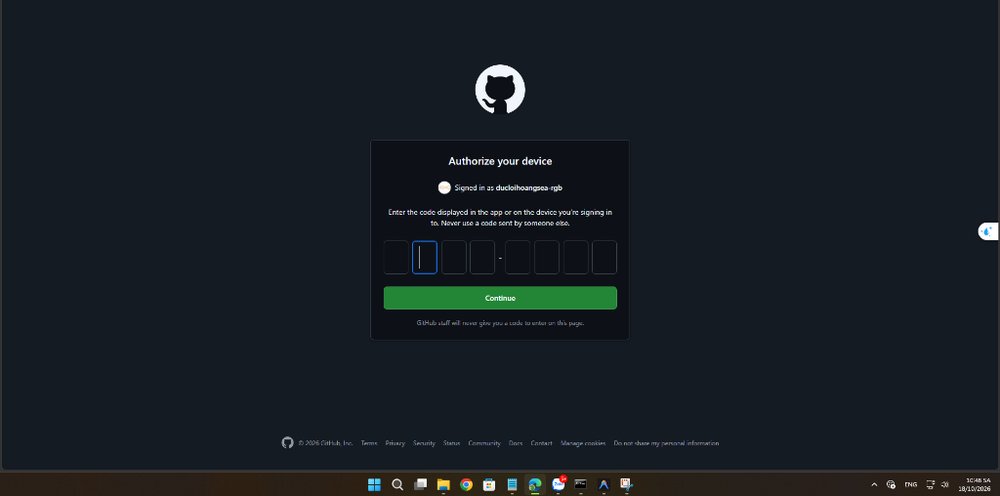

# 🚀 CHIẾN HẠM VÔ CỰC (COSMIC SURVIVOR: DOPAMINE OVERLOAD)

> **Game bắn phi thuyền Roguelite sinh tồn không gian với nhịp độ dồn dập, đồ họa Cyberpunk phát sáng mượt mà 60 FPS, hệ thống nâng cấp phân cấp độ hiếm Thần Thoại và hàng loạt hạm đội phi thuyền độc bản!**

🎮 **Chơi trực tiếp trên Web/Điện thoại**: [https://ducloihoangsea-rgb.github.io/cosmic-survivors/](https://ducloihoangsea-rgb.github.io/cosmic-survivors/)

---

## 📸 Hình Ảnh Trò Chơi (Screenshots)

<div align="center">
  
  <p><i>Màn hình chọn Phi Thuyền Xuất Trận với mô hình 3D Canvas động, thông số và nội tại riêng biệt</i></p>
</div>

---

## 🌟 Tính Năng Nổi Bật

### 1. 🛸 Hệ Thống Phi Thuyền Đa Phong Cách (Cân Bằng Chuẩn)
Mỗi tàu sở hữu đúng **1 chỉ số vượt trội riêng biệt**, phong cách chiến đấu và vũ khí khởi đầu khác nhau:
- 🛡️ **Thiết Giáp Juggernaut**: **Siêu Máu & Giáp (100 HP - Tối đa 240)**. Lấy thân tàu tông thẳng húc văng quái gây 140 sát thương, tông chết quái hồi ngay +2 HP. Giảm 65% sát thương va quẹt.
- 🩸 **Huyết Đao Berserker**: **Siêu Công & Bạo Kích (100 Công - Crit x2.6)**. Máu càng tụt hỏa lực càng điên cuồng (tăng tới +180% Damage & +120% tốc đánh), 12% hút máu, bất tử 3s khi nhận đòn chí tử.
- 🎯 **Xạ Thủ Phantom**: **Siêu Tốc Độ Lướt (100 Tốc độ - 285 px/s)**. Bắn tỉa tầm xa +85% sát thương, né đòn 3s đòn kế tiếp chắc chắn chí mạng x300%, đạn xuyên táo +2 mục tiêu.
- 🛸 **Hạm Trưởng Carrier**: **Siêu Tầm Bắn & Phễu Gom Ngọc (100 Tầm bắn - 180 px hút)**. Bắt đầu ngay với cả 2 vũ khí: Drone Đồng Minh + Tên Lửa Tầm Nhiệt, drone xả đạn nhanh hơn +35%.
- 🌌 **Tiên Phong Nebula (Tàu Hiếm ⭐)**: **Tàu Hybrid 2 Chỉ Số Vượt Trội (Công Cao 90 & Tốc Cao 90)**. Chiến hạm Hư Không sở hữu cả Sét Chuỗi và Súng Plasma liên thanh.

### 2. 📊 Bảng Theo Dõi Real-time (Thu Gọn / Mở Rộng)
- **Nút DPS**: Xem chi tiết phần trăm sát thương theo thời gian thực của từng loại kỹ năng (Súng Plasma, Quả Cầu Xoay, Sét Chuỗi, Đĩa Năng Lượng, Tên Lửa Tầm Nhiệt, Drone...).
- **Nút CHỈ SỐ**: Xem chi tiết các thuộc tính thực của phi thuyền đang bay: Máu hiện tại/tối đa, Tốc độ chạy thực tế (px/s), % Sát thương khuếch đại, % Tốc đánh, Tỉ lệ Chí mạng & Sát thương bạo kích, Bán kính hút ngọc, % Tầm nhìn đại bàng.

### 3. 🌗 Hỗ Trợ Chế Độ Sáng / Tối (Light Mode & Dark Mode)
- Nút chuyển nhanh theme ☀️ / 🌙 ngay trên HUD và Menu khởi động.
- Tự động lưu thiết lập theme vào `localStorage`.

### 4. ⚡ Nâng Cấp Phân Cấp Độ Hiếm & Thần Thoại Đỏ (1-2%)
- **Hệ thống độ hiếm**: Trắng (Thường) ➔ Xanh (Hiếm) ➔ Tím (Sử Thi) ➔ Vàng (Huyền Thoại) ➔ **Đỏ (Thần Thoại)**.
- **Kỹ năng Đỏ Thần Cấp**:
  - ⚡ *Khế Ước Định Mệnh*: Lần nâng cấp kế tiếp chỉ ra duy nhất 1 lựa chọn Đỏ tối thượng.
  - 🕳️ *Hố Đen Điểm Kỳ Dị*: Gom sạch và nghiền nát toàn bộ quái vật định kỳ.
  - 🩸 *Huyết Thần Thịnh Nộ*: +100% Damage toàn phần, tiêu diệt quái hồi máu.
  - 💀 *Lưỡi Hái Đoạt Hồn*: 10% tỉ lệ kết liễu quái tức thì (One-hit Kill).
  - ⏳ *Thời Không Ngưng Đọng*: Đóng băng toàn bộ quái trong 5 giây.
  - 👁️ *Radar Mắt Đại Bàng*: Mở rộng tầm nhìn bao quát toàn đấu trường +35%.

### 5. 🏠 Nút Thoát Menu & Xưởng Công Nghệ Vĩnh Viễn
- Nút 🏠 trên HUD cho phép dừng trận đấu và quy đổi toàn bộ điểm số thành Vàng.
- Dùng Vàng nâng cấp vĩnh viễn: Giáp Tàu, Lò Phản Ứng, Nam Châm, Bảo Hiểm Tái Sinh và Máy Đào Vàng.

---

## 🌐 Kế Hoạch Đa Người Chơi (Multiplayer Online)

Để hiện thực hóa tính năng chơi Online nhiều người cùng lúc (Co-op sinh tồn hoặc PvP đối đầu), kiến trúc triển khai được thiết kế:
1. **P2P Multiplayer qua WebRTC (PeerJS)**: Người chơi tạo phòng (Room ID) và gửi mã cho bạn bè vào cùng phòng mà không cần thuê server trung gian tốn kém.
2. **Dedicated Server qua Node.js WebSocket / Colyseus**: Đồng bộ trạng thái quái vật, vị trí phi thuyền của người chơi và bảng điểm tổng thời gian thực.

---

## 🛠️ Công Nghệ Sử Dụng

- **Engine Logic**: Vanilla JavaScript (ES Modules, Không phụ thuộc thư viện nặng).
- **Đồ Họa**: HTML5 Canvas 2D Vector Rendering tự vẽ mượt mà, không tốn ram tải texture.
- **Âm Thanh**: Web Audio API tổng hợp âm thanh điện tử tức thì (Zero-latency Synthesizer).
- **Build Tool**: Vite 6.
- **Hosting & CI/CD**: GitHub Actions tự động Deploy lên GitHub Pages.

---

## 🚀 Hướng Dẫn Chạy Cục Bộ (Local Development)

```bash
# 1. Cài đặt thư viện
npm install

# 2. Khởi động server phát triển
npm run dev

# 3. Đóng gói bản chạy Production
npm run build
```

---

*Phát triển bởi ducloihoangsea-rgb © 2026. Chúc bạn chơi game bùng nổ Dopamine!*
