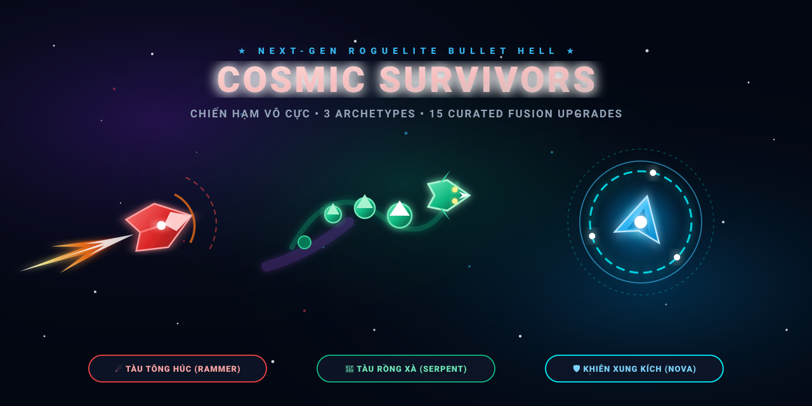

<div align="center">

  

  # 🚀 COSMIC SURVIVORS: CHIẾN HẠM VÔ CỰC
  ### Next-Gen Roguelite Bullet Hell & Kinetic Combat

  [](https://vitejs.dev/)
  [](https://developer.mozilla.org/en-US/docs/Web/JavaScript)
  [](https://html.spec.whatwg.org/)
  [](https://developer.mozilla.org/en-US/docs/Web/API/Web_Audio_API)
  [](https://github.com/ducloihoangsea-rgb/cosmic-survivors)

  <p align="center">
    <b>🎮 Trải nghiệm ngay trên trình duyệt (Web & Mobile):</b><br/>
    <a href="https://ducloihoangsea-rgb.github.io/cosmic-survivors/" target="_blank">
      
    </a>
  </p>

</div>

---

## 🌌 Giới Thiệu (Overview)

**Cosmic Survivors** là trò chơi sinh tồn bắn phi thuyền không gian phong cách Roguelite nhịp độ dồn dập, đồ họa Neon Cyberpunk tự vẽ vector mượt mà 60 FPS, âm thanh điện tử tổng hợp qua Web Audio API không độ trễ. 

Khác biệt với các tựa game Survivor truyền thống chỉ tập trung vào xả đạn thụ động, Cosmic Survivors đưa vào cơ chế **Kinetic Combat (Vật lý va chạm, húc tông, quấn đốt và bom khiên xung kích)** với 3 đại diện phi thuyền mang lối chơi đối nghịch hoàn toàn, cùng hệ thống **Bể Nâng Cấp Tinh Gọn 15 Thẻ (Chọn 1 trong 3)** loại bỏ hoàn toàn thẻ rác, tạo nên tính đột biến chiến thuật đỉnh cao trong mỗi lượt chạy.

---

## 🛸 Ba Thân Tàu Khởi Đầu (Gameplay Archetypes)

Mỗi chiến hạm đại diện cho một cơ chế vật lý và triết lý chiến đấu độc bản:

| Chiến Hạm | Ngoại Hình & Cơ Chế | Nội Tại Đặc Biệt | Lối Chơi Trọng Tâm |
| :--- | :--- | :--- | :--- |
| **☄️ Tàu Tông Húc<br/>(Meteor Rammer)** | Thân tàu giáp nặng đỏ rực, vệt lửa đẩy cực đại | • Sát thương va chạm cực lớn (180 dmg × Khối lượng × Tốc độ)<br/>• Giảm **70%** sát thương khi đâm trực diện quái<br/>• Tiêu diệt quái bằng húc hồi ngay **+2 HP**<br/>• Đẩy văng bầy quái xung quanh 80px | Tăng tốc lao thẳng vào giữa bầy địch như một khối thiên thạch bọc thép. |
| **🐉 Tàu Rồng Xà<br/>(Cyber Serpent)** | Đầu rồng ngọc lục bảo nối đuôi bởi chuỗi đốt thân bọc thép | • Khởi đầu với **4 đốt thân** nối đuôi (tối đa 10 đốt)<br/>• Đốt thân triệt tiêu **100% đạn địch** bay vào<br/>• Sát thương quẹt xé rách **85 dmg/tick**<br/>• Kích nộ phóng sóng xung kích làm chậm | Uốn lượn bo tròn để cô lập, quấn xiết tiêu diệt bầy quái số lượng đông. |
| **🛡️ Khiên Xung Kích<br/>(Nova Shield)** | Lõi phát quang cyan bao bọc bởi mái vòm từ trường | • **Không có súng thường**<br/>• Lớp khiên độc lập 160 HP hấp thu mọi sát thương<br/>• Khiên vỡ (hoặc bấm Space) kích nổ **Sóng Nova** 160px gây 320 dmg<br/>• Tự sạc lại sau 3.5 giây | Áp sát bầy địch, chủ động va chạm hoặc kích nổ bom khiên diện rộng. |

---

## 🎴 Bể Nâng Cấp Tinh Gọn: Chọn 1 Trong 3 (Curated Roguelite Pool)

Thay vì hàng trăm thẻ loãng và trùng lặp, game tinh giản thành **15 nâng cấp cốt lõi** phân bổ chặt chẽ theo 3 nhóm chuyên sâu:

### 1. 📊 Nhóm Nâng Cấp Chỉ Số (Phổ Thông)
- 🚀 **Gia Tốc (Thrust)**: Tốc độ bay **+25%**, tốc độ xoay tàu **+15%**. Cải thiện độ linh hoạt khi lượn lách né đạn.
- 🛡️ **Khuếch Đại (Juggernaut)**: Tăng **40%** kích thước và khối lượng tàu, **+30%** máu tối đa, giảm 15% tốc độ xoay. Tăng uy lực đâm húc kinh hoàng.
- 🛸 **Thu Nhỏ (Micro-Craft)**: Giảm **30%** kích thước hitbox, tốc độ bay **+35%**. Tàu trở nên siêu bé, né đạn dễ dàng.
- 🔋 **Lõi Năng Lượng (Energy Core)**: Tốc độ sạc khiên **+40%**, giảm thời gian trễ hồi phục khiên.
- 🐉 **Mọc Đốt (Grow Segments)**: Thêm **2 đốt thân** phía sau (đối với Tàu Rắn) hoặc kích hoạt kéo dài **Vệt Lửa Phản Lực** gây thiêu đốt (đối với các tàu khác).
- 💉 **Sửa Chữa Khẩn Cấp (Nanorepair)**: Hồi phục khẩn cấp **60 HP** và tăng thêm **25 Máu Tối Đa**.

### 2. 🌪️ Nhóm Đột Biến Lối Chơi (Biến Đổi Cơ Chế)
- 🌪️ **Đâm Xuyên (Drill)**: Khi húc chết quái, tàu không bị khựng quán tính mà tiếp tục phóng thẳng xuyên qua đội hình địch.
- 🔥 **Khiên Lửa (Burn Field)**: Khiên liên tục phát tỏa vầng hào quang thiêu đốt toàn bộ quái vật trong bán kính xung quanh.
- 💫 **Đạn Nảy (Ricochet)**: Đạn plasma hoặc mảnh vỡ khi va chạm mục tiêu tự động nảy sang các quái lân cận trong tầm 240px.
- ☣️ **Khí Độc Đuôi (Toxic Exhaust)**: Đuôi tàu (hoặc các đốt thân rồng) xả khói độc tím làm chậm quái **40%** và rút máu liên tục.
- 🌵 **Gai Phản Đòn (Spiked Thorns)**: Phản lại **100% sát thương va chạm** trực tiếp lên quái vật tấn công.

### 3. 💥 Nhóm Siêu Nâng Cấp (Fusion Mods - Xuất Hiện Từ Cấp 10+)
- 💥 **Bom Quán Tính (Crash Nova)**: Mỗi khi thân tàu va chạm trúng mục tiêu, lập tức kích nổ một đợt sóng khiên Nova diện rộng (Synergy tối thượng giữa Tàu Húc & Tàu Khiên).
- 🐲 **Mãng Xà Bọc Thép (Iron Dragon)**: Toàn bộ đốt thân rắn được bọc thép gai nhọn; quái chạm vào đốt thân bị **hất văng 120px** và chịu sát thương cực lớn.
- ⚚ **Bất Tử Hóa (Immortality)**: Toàn bộ bình máu chuyển đổi thành 1 lớp khiên năng lượng duy nhất; bù lại sát thương nổ sóng khiên **tăng gấp 3 lần**.
- ☢️ **Bom Hạt Nhân (Tactical Nuke)**: Thanh trừng lập tức toàn bộ quái vật hiện diện trên màn hình trong nháy mắt.

### 4. ⚡ Kỹ Năng Đỏ Thần Thoại (Mythic - Tỷ Lệ Hiếm 1.5%)
- ⚡ **Khế Ước Định Mệnh (God Pact)**: Chấp thuận khế ước, lần nâng cấp kế tiếp chỉ ra duy nhất 1 thẻ bài Thần Thoại tối thượng.
- 🕳️ **Hố Đen Điểm Kỳ Dị (Cosmic Singularity)**: Khởi tạo hố đen khổng lồ nghiền nát bầy quái vật.
- 🩸 **Huyết Thần Thịnh Nộ (Blood God Rampage)**: Sát thương tăng gấp đôi, tiêu diệt quái hồi sinh lực.
- 💀 **Lưỡi Hái Đoạt Hồn (Reaper Execution)**: Cơ hội kết liễu quái vật tức thì (One-hit Kill).
- ⏳ **Thời Không Ngưng Đọng (Chronos Stasis)**: Đóng băng toàn bộ thời gian trong không gian 5 giây.

---

## 📱 Tối Ưu Hóa Trải Nghiệm Thiết Bị Di Động (Mobile First)

- **Giao diện không góc chết**: Tự động nhận diện thiết bị cảm ứng, căn chỉnh khoảng cách an toàn (Safe Area), không bị khuất tiêu đề hay phím bấm chức năng.
- **Tự động tắt con trỏ chuột**: Ẩn triệt để con trỏ chuột trên mobile, giữ màn hình sạch sẽ, không vướng tầm nhìn ngón tay.
- **Nút Chức Năng Cột Dọc Thuận Tiện**: Hai nút **DPS** và **CHỈ SỐ TÀU REAL-TIME** được gom vào cùng 1 cột dọc bên trái, kích thước phím bấm lớn dễ chạm bằng một ngón tay cái.
- **Modal Toàn Màn Hình Tinh Gọn**: Khi mở Bảng Thăng Cấp (Level-up) hoặc Xưởng Phi Thuyền (Hangar), toàn bộ HUD nền được làm mờ/che đi để người chơi tập trung tối đa; khi trở lại trận đấu hiển thị đầy đủ ngay lập tức.

---

## 🏛️ Xưởng Phi Thuyền & Nâng Cấp Vĩnh Viễn (Hangar)

Trong giao diện Xưởng Phi Thuyền:
- **Canvas Xem Trước 3D Vector**: Mô hình phi thuyền xoay 360 độ kèm hiệu ứng ánh sáng động.
- **Bảng Tra Cứu Chỉ Số & Cơ Chế**: Hiển thị rõ ràng chỉ số chi tiết, nội tại đặc trưng và vũ khí xuất phát.
- **Gợi Ý Nâng Cấp Hợp Thể (Synergies)**: Đề xuất sẵn danh sách các thẻ nâng cấp ăn khớp nhất với cấu tạo của từng loại thân tàu.
- **Công Nghệ Cốt Lõi Vĩnh Viễn**: Dùng Vàng tích lũy sau các trận đấu để nâng cấp Giáp, Hút Ngọc, Sát Thương, Tái Sinh và Kinh Tế.

---

## 🛠️ Cài Đặt & Chạy Cục Bộ (Local Development)

```bash
# 1. Clone mã nguồn về máy
git clone https://github.com/ducloihoangsea-rgb/cosmic-survivors.git

# 2. Di chuyển vào thư mục dự án
cd cosmic-survivors

# 3. Cài đặt các gói phụ thuộc
npm install

# 4. Khởi động môi trường phát triển (Dev Server)
npm run dev

# 5. Đóng gói bản Production hoàn chỉnh
npm run build
```

---

## 📄 Giấy Phép & Bản Quyền

Dự án được xây dựng và phát triển độc quyền bởi **ducloihoangsea-rgb** © 2026. Mọi đóng góp (Pull Request) và phản hồi đều được chào đón!
